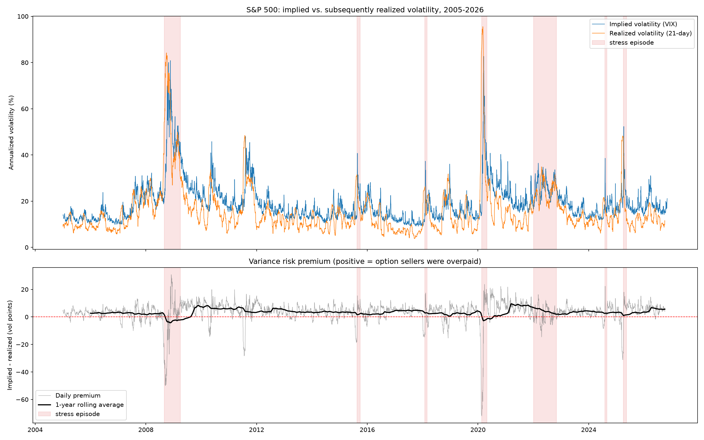

# Is Selling S&P 500 Volatility a Free Lunch?

*Erdős Institute Quant Finance Boot Camp, Fall 2026 · Nahid Hasan Sagar, Kevin Specht, Anatolii Vakaryuk*

**Short answer: no.** Selling S&P 500 volatility has paid on average since 2005, but the payoff is compensation for crash risk. The average is only borderline significant once crashes are counted properly, and in real, delta-hedged options the edge is thin.



## Deliverables
- **Executive summary (2 pages):** [`docs/executive_summary/executive_summary.pdf`](docs/executive_summary/executive_summary.pdf), with its LaTeX source next to it
- **Video presentation:** [link to the video] <!-- add the YouTube / Google Drive link here -->
- **Notebooks:** `notebooks/01`–`04`, described below

## Headline results
| Question | Answer | Notebook |
|---|---|---|
| Is there a premium? | VIX was above the volatility that followed on **84% of days**, by **3.5 vol points** on average. **82% of non-overlapping months** were profitable for the seller (sign test p ≈ 2.7 × 10⁻²⁷). | 02 |
| Is the *average* significant? | Only borderline. The Newey–West t-statistic is **2.1–2.3** (the naive t is 8.9), and the non-overlapping t ranges from **1.6 to 2.6** depending on the start day. Skew is −5.4 and excess kurtosis 42: March 2020 alone erased about 46 typical months. | 02 |
| Which crises hurt? | Sudden ones. A one-month swap sold on day 1 lost **72 vol points in COVID**, 32 in 2008 and 26 in April 2025, but only **2 in the slow 2022 bear market**. | 02 |
| Can it be forecast? | **VIX² beats a HAR model** (QLIKE 0.37 vs 0.39) despite being biased upward by 0.008, and that bias is the premium. HAR beats last month's variance (QLIKE 0.57). | 03 |
| Can it be timed? | A rule fixed in advance (below) keeps the mean and, across all 21 start days of the 2016+ test, raises the median Sharpe from **0.36 to 1.20** and improves the median worst month from −0.73 to −0.18. On the unluckiest start day it still takes the COVID loss (−0.80 vs −0.82). | 03 |
| Does it survive in real options? | A daily delta-hedged short ATM straddle earns **+0.77% of the index per month** priced at VIX, **+0.32%** at VIX − 2 points and **about zero** at VIX − 3 after option costs. Gamma–theta attribution explains the P&L with **correlation 0.98**. With the rule, the 2016+ Sharpe rises from 0.91 to 1.29. | 04 |

## Repository
| Path | What it does |
|---|---|
| `notebooks/01_data.ipynb` | Downloads the data and builds `data/daily.csv`; six data checks |
| `notebooks/02_premium.ipynb` | Measures the premium; Newey–West and non-overlapping tests; payoff shape; crisis episode table |
| `notebooks/03_har_forecast.ipynb` | Expanding-window HAR forecast, forecast accuracy, trading rule, out-of-sample test with start-day robustness |
| `notebooks/04_straddle_backtest.ipynb` | GBM hedging sanity check; delta-hedged short straddle backtest; gamma–theta attribution; rule applied to straddles |
| `src/data.py` | Data download, realized-variance and premium definitions, stress-episode dates |
| `src/bs.py` | Black–Scholes prices and Greeks for calls, puts and straddles (vectorized) |
| `tests/test_core.py` | Checks: forward-sum alignment (no look-ahead), put–call parity, Greeks vs finite differences, the data build on simulated prices |
| `data/daily.csv` | The shared daily dataset, Jan 2005 – Nov 2026, including the HAR forecast and the trading signal |
| `docs/` | Executive summary (PDF and LaTeX) and all figures |

## How to reproduce
```bash
pip install -r requirements.txt
python -m pytest -q          # 4 checks should pass
jupyter lab                  # run the notebooks in order: 01 → 02 → 03 → 04
```
- Notebook 01 re-downloads the data (free sources: Yahoo Finance `^GSPC`, `^VIX`, `^VIX3M`; FRED `DTB3`). To reuse the committed `data/daily.csv` instead, skip 01.
- Notebook 03 adds `har_fcst`, `fcst_vrp` and `signal` to `data/daily.csv`; notebook 04 needs them, so run 03 before 04.
- Tested with Python 3.14.

## Method and conventions
- **Underlying:** the S&P 500 index (`^GSPC`), the index VIX is computed on.
- **Returns:** close-to-close log returns. **Realized variance:** annualized (×252) over the next 21 trading days.
- **Premium:** `vrp = VIX²/10000 − RV(next 21 days)`. This equals the payoff of a short one-month variance swap per unit of variance notional.
- **Inference:** overlapping daily data use Newey–West standard errors (21, 30 and 42 lags). Non-overlapping tests use every 21st day, repeated for all 21 start offsets.
- **Forecast:** HAR-RV, `RV(next 21) ~ RV_day + RV_week + RV_month`, refit at each month start on rows whose target was already known. Scored by MSE and QLIKE.
- **Straddles:** sold at the close on the first trading day of each month, K = S, T = 30/365, priced with Black–Scholes at VIX/100 minus a 0–3 vol-point haircut, delta hedged at every close, settled on the last trading day on or before expiry. Option cost: 0.5 vol point × vega.

## Trading rule (fixed before testing on 2016 onwards)
Sell one month of variance on day t only if, at the previous close,
1. the forecast premium VIX²/10000 − HAR forecast is positive, and
2. VIX/VIX3M < 1 (the VIX curve is not inverted).

Otherwise hold cash. Nothing is tuned. Train 2008–2015, test 2016+, run once. The rule was committed in `c7a3c45` (4 Nov 2026, 14:50 ET) before the test period was run.

## Limitations
| Assumption | Likely effect | How we controlled for it |
|---|---|---|
| Straddles priced at VIX, which includes out-of-the-money puts | Overstates the at-the-money premium | Haircuts of 0–3 vol points; the 2–3 point rows are the realistic ones |
| Few independent crashes (three in the 2016+ test) | Tail and Sharpe estimates are noisy | Non-overlapping tests over all 21 start days; tail statistics reported, not just means |
| Simplified costs: no hedge costs, bid–ask, margin or dividends | Overstates net P&L | Net-of-cost column; the edge is about zero at a 3-point haircut |
| Straddles enter on the first trading day of each month only | Results depend on the calendar | Start-day robustness shown for the variance swap; not yet repeated for straddles |
| Rule chosen with hindsight | Inflates out-of-sample results | Rule committed before testing; signal uses the previous close; HAR refit on past data only |

## Contributions
- **Nahid Hasan Sagar:** data pipeline, premium measurement and tests, crisis analysis, HAR forecast and trading rule, straddle backtest and attribution, executive summary, slides and video.
- **Kevin Specht:** initial GBM path simulation in notebook 04.
- **Anatolii Vakaryuk:** joined the team late; helped with writing and editing, and gave feedback on the final report.

AI tools (Claude) were used for coding help, debugging and drafting text, as the boot camp allows. All analysis was run, checked and interpreted by the authors.